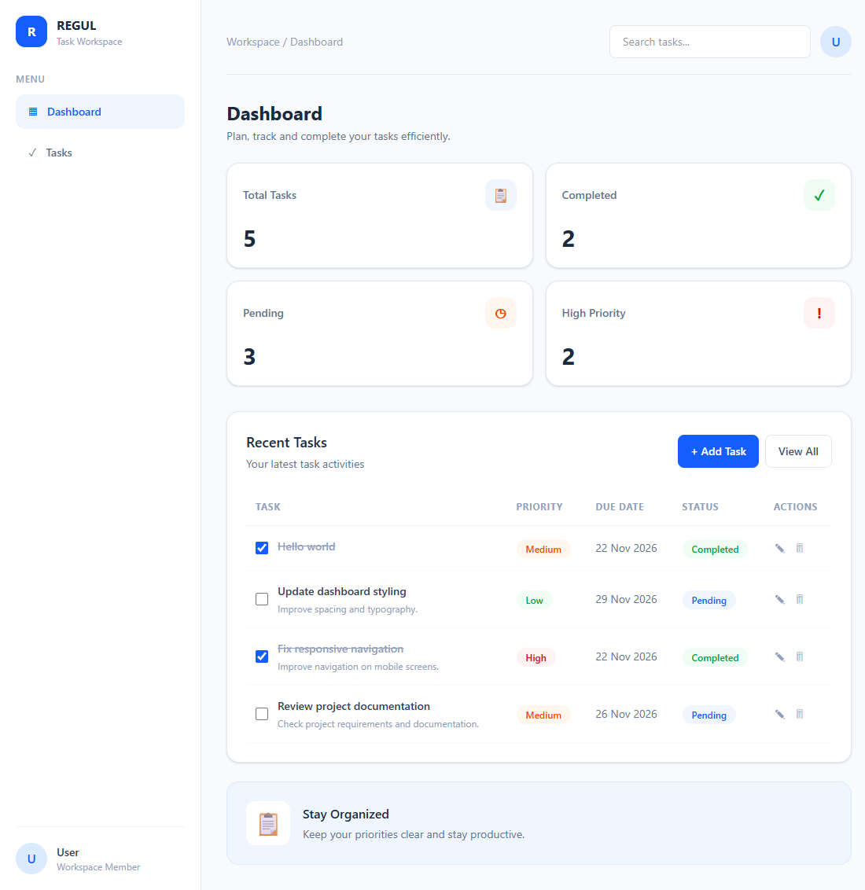
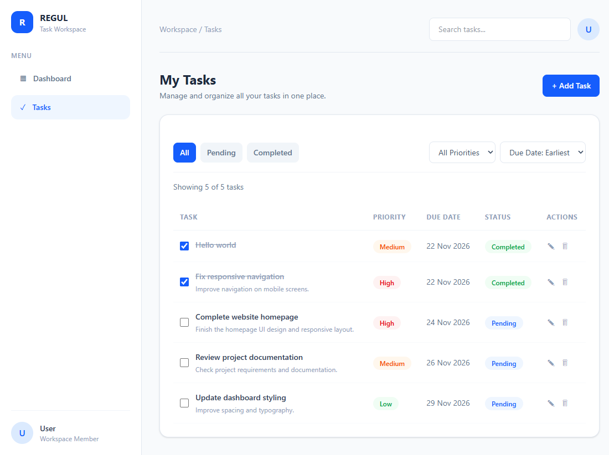

# Task Management Dashboard

A responsive Task Management Dashboard built using **React, JavaScript, and Tailwind CSS**. This application helps users organize, track, and manage their daily tasks through a simple and user-friendly interface.

## Features

- **Dashboard Overview:** Displays total tasks, completed tasks, pending tasks, and high-priority tasks.
- **Task Management:** Add, edit, and delete tasks.
- **Task Details:** Each task includes a title, description, priority, due date, and status.
- **Search Tasks:** Search tasks by title.
- **Filter Tasks:** Filter tasks by status and priority.
- **Sort Tasks:** Sort tasks based on due date.
- **LocalStorage:** Saves tasks in the browser so they remain available after refreshing the page.
- **Navigation:** Separate Dashboard and Tasks pages using React Router DOM.
- **Responsive Design:** Works across desktop, tablet, and mobile screen sizes.

## Technologies Used

- React.js
- JavaScript
- Tailwind CSS
- React Router DOM
- HTML5
- LocalStorage

## Project Structure

```text
src/
├── components/
│   ├── Sidebar.jsx
│   ├── Header.jsx
│   ├── StatsCard.jsx
│   ├── TaskList.jsx
│   ├── TaskModal.jsx
│   └── TaskFilters.jsx
│
├── pages/
│   ├── Dashboard.jsx
│   └── Tasks.jsx
│
├── App.jsx
├── index.css
└── main.jsx
```

## Installation and Setup

Follow these steps to run the project locally.

### 1. Clone the Repository

```bash
git clone <your-repository-url>
```

### 2. Navigate to the Project Folder

```bash
cd <project-folder-name>
```

### 3. Install Dependencies

```bash
npm install
```

### 4. Install React Router DOM

If it is not already included in your dependencies, run:

```bash
npm install react-router-dom
```

### 5. Start the Development Server

```bash
npm run dev
```

### 6. Open the Application

Open the local URL displayed in your terminal, usually:

```text
http://localhost:5173
```

## How to Use

1. Open the Dashboard to view task statistics and recent tasks.
2. Navigate to the Tasks page to view all tasks.
3. Click **Add Task** to create a new task.
4. Enter the task title, description, priority, due date, and status.
5. Use the Edit option to update an existing task.
6. Use the Delete option to remove a task.
7. Use the search bar to find tasks by title.
8. Apply status and priority filters to find specific tasks.
9. Sort tasks by due date.
10. Refresh the browser to verify that tasks are saved in LocalStorage.

## Data Storage

This project uses the browser's **LocalStorage** to store task information.

- No backend or database is required.
- Task data is saved locally in the browser.
- Data remains available after refreshing the page in the same browser and origin.

## Future Improvements

- Backend and database integration.
- User authentication.
- Task reminders and notifications.
- Improved form validation.
- Unit and integration testing.


---

## Screenshots

### 1. Dashboard Page


### 2. Task Page


## Author

Developed as a frontend technical assessment project for **REGUL SOFTECH SOLUTION PRIVATE LIMITED**.